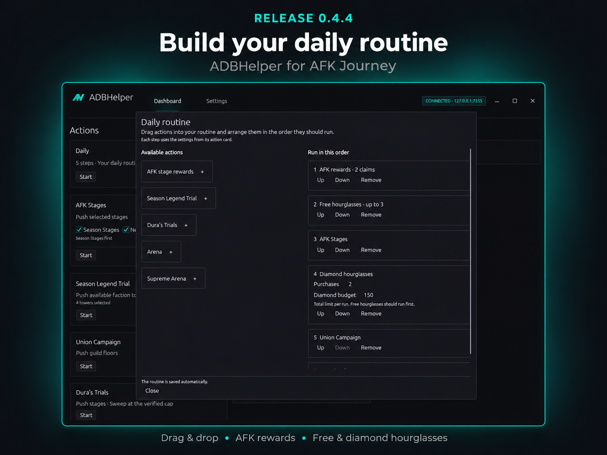

# ADBHelper 0.4.4

Build your own daily routine for AFK Journey.

## Daily routine builder

- Added a **Daily** card at the top of the dashboard. Open its gear to build your routine.
- Drag actions into the routine and reorder them. Add, Remove, Up, and Down controls are also available.
- The routine and its order are saved automatically between app launches and updates.
- Include AFK Stages, Season Legend Trial, Union Campaign, Dura's Trials, Arena, and Supreme Arena. Each step uses its action card's settings.
- Steps run from top to bottom. **Stop** ends the whole routine; a technical error prevents later steps from starting.
- Season stages still run before normal stages when both are selected within the AFK Stages action.

## AFK rewards and hourglasses

- The default routine collects the AFK chest **twice** for daily progress, then claims up to **three available free Instant AFK hourglasses**.
- Each collection is checked before its counter increases. The free step ends when the game shows a diamond price.
- Added an optional **Diamond hourglasses** step with a purchase count and a **total diamond budget per run**, configured directly in the routine editor.
- Its initial limits are **one purchase and 50 diamonds**. A zero budget disables spending. Existing routines do not gain a paid step automatically.
- Run free hourglasses before the paid step. The price is checked twice before each purchase, and the exact diamond balance is checked before and after it.
- The game can spend diamonds immediately when the hourglass is tapped. ADBHelper reserves the budget before that tap and stops if the charge cannot be confirmed.
- Added optional **AFK stage rewards** collection, based on AdbAutoPlayer's reward workflow. Recognized claim dialogs and reward overlays are handled; unconfirmed rewards are not counted.

## Activity and statistics

- AFK rewards, free hourglasses, diamond hourglasses, and stage rewards have separate collection counters.
- Collection steps do not inflate combat attempts, wins, cleared stages, or the mode-comparison chart.
- The activity counters can scroll as more modes are added; the current-mode display remains visible.

## Validation

- 113 automated tests passed. Device and screenshot diagnostics are opt-in and excluded from the normal test run.
- Live checks covered two AFK chest collections, the remaining free hourglasses, automatic navigation, and reading paid hourglass prices and the diamond balance.
- The no-available-stage-rewards path was checked live. Claiming an available stage reward and the complete automated paid-purchase path still need live validation.

## Update

Use the green update icon beside **Settings**, or download **ADBHelper-Windows-x64.exe** below. The app remembers your saved routine.

Workflow inspiration and original recognition templates: [ADBAutoPlayer](https://github.com/AdbAutoPlayer/AdbAutoPlayer).
