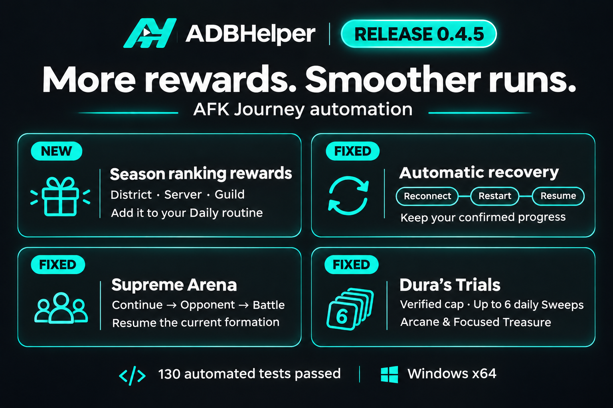

# ADBHelper 0.4.5

More rewards. Smoother runs.

## New: Season Phase Ranking rewards

- Add **Season Phase Ranking rewards** to your Daily routine via its gear popup. Existing saved routines keep their steps; the new action is optional.
- Automatically navigate from the AFK page to Season Phase Rankings and check **District**, **Server**, and **Guild** first-clear rewards for the available phases.
- Claim only recognized, enabled green Claim controls. Count a collection only after the matching stage row changes to **Claimed**.
- Skip already claimed or locked rewards and older phases without a first-clear section. Gift badges keep the search active when rewards are outside the visible list.
- Each scope has its own Activity collection counter. These rewards do not inflate combat wins, attempts, or cleared stages.

## Recovery and interrupted runs

- Fixed actions stopping after **ADB command failed: error: closed**, temporary device disappearance, or offline transport errors. ADBHelper reconnects the affected device and retries the game health check before deciding whether to restart.
- All action families, including Daily steps, share recovery. Restart AFK Journey when its process disappears or Android Home is visible, even if a background game process survives.
- Resume the current mode or Legend Trial tower, retaining confirmed counters and PvE team-attempt budgets. Completed Season stages and earlier towers are not replayed. Interrupted, unconfirmed fights are not counted as wins.
- Interrupted free Daily collections re-enter their verified AFK page. Unconfirmed chest or stage-reward receipts stay uncounted; paid hourglass receipts still require proof of the charge before another purchase.
- Arena and Supreme Arena now restart and return to their mode when result closing or a required Arena view/control times out, even while the game process is healthy. Saved PvP attempt budgets survive recovery.
- **Stop** prevents further recovery input. Connection retries and game restarts remain bounded to avoid endless loops; at most three game restarts are allowed per action.

## Supreme Arena

- Reworked the **Continue** flow to recognize the overview, opponent selection, opponent details, and existing team formations. Resume from the current view and use the configured opponent position when choosing a card.
- Added an OCR fallback for **Select Opponent**, checked against independent My Rank and Refresh controls.
- Wait for a verified formation after Challenge. Advance only the remaining Next screens; an already open Battle screen no longer requires two more Next taps.
- Close the **Daily Ranking Rewards** table with Back. The Daily Rewards entry is no longer opened while trying to dismiss a post-battle notice.
- Unverified purchase or confirmation dialogs still stop the action. Recovery does not authorize extra purchases.

## Dura's Trials and OCR

- Fixed **The Sweep dialog could not be verified** for **Arcane Treasure** and **Focused Treasure** when the floor number or the whole Floor label wraps onto the next line.
- Handle the observed decorative initial letters omitted by OCR while still requiring the same trial, confirmed maximum stage, quantity, daily token, and total cost before confirming a Sweep.
- Continue to set up to **six available daily Sweeps** per batch, verify the counter decrease, and record Sweeps separately from combat statistics. Stock tokens and paid attempts remain excluded.
- Windows OCR now reuses a dedicated worker and recognition engine across frames and action runs, instead of repeatedly opening and closing the Windows Runtime.

## Validation

- **130 automated tests passed.** Emulator and captured-image checks remain opt-in.
- Live Season Phase Ranking checks collected one Server and one Guild reward. Subsequent full runs made no duplicate collections; already claimed District rewards and an older phase without first-clear rewards were skipped.
- Live recovery checks covered a game exit with disconnected ADB, Android Home with a surviving process, and a result-closing failure with the game still running. Each returned to the saved mode or tower.
- Supreme Arena navigation was checked from the overview, opponent cards, and opponent details through the Battle button, including resuming the final formation. Those checks did not start a PvP battle.
- Arcane and Focused Treasure both completed **six daily Sweeps at the verified floor-25 cap**, with the daily counter decreasing from six to zero and six Sweeps recorded.

## Update

Click the green update icon beside **Settings**, review these patch notes, and choose **Download and install**. Or download **ADBHelper-Windows-x64.exe** below. Saved routines and settings are retained.

Workflow inspiration and original recognition templates: [ADBAutoPlayer](https://github.com/AdbAutoPlayer/AdbAutoPlayer).
