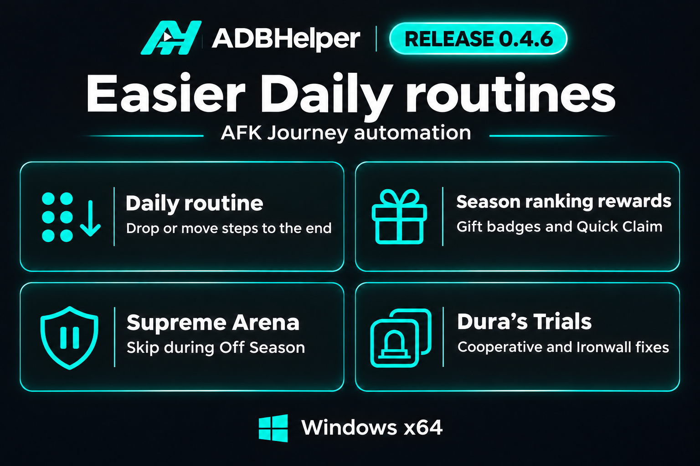

# ADBHelper 0.4.6

Put Daily steps in the order you want, collect ranking rewards beyond the visible list, and keep your routine moving through Supreme Arena's Off Season.

## Daily routine editor

- Drag a new or existing step onto the fixed drop area below the list to place it last. The area stays visible when the routine is longer than the window.
- Drag near the top or bottom of the list to scroll to another position. Each step also has a **To end** button, and the editor brings the last step into view after the move.

## Season Phase Ranking rewards

- Check the gift badge on each **District**, **Server**, and **Guild** tab before collecting. Tabs without a badge are skipped.
- Use **Quick Claim** when the active tab has a gift badge and no individual Claim button can be read. This also collects rewards outside the visible rows.
- Count a Quick Claim batch as one collection after the gift badge disappears from the active tab on two verified views.

## Supreme Arena

- Skip Supreme Arena during **Off Season** and continue to the next Daily step. The check covers entering the mode and a season ending during a run.

## Dura's Trials

- Fixed stage and title recognition for **Cooperative Treasure** and **Ironwall Treasure**, including stage numbers that overlap portraits and wrapped Sweep dialog labels.
- Start the free first-clear battle when the stage is available. Sweeps still require a verified cap, the matching trial and stage, and verified daily token costs and quantity.

## Validation

- **136 automated tests passed.** Captured reward views covered Quick Claim with off-screen rewards and independent gift badges. A live test confirmed three Guild collections and a repeat run collected nothing.
- A live Daily check skipped Supreme Arena during Off Season and reached the next step.
- Live tests cleared Cooperative Treasure stages **27–30** and Ironwall Treasure stage **30**. The Sweep dialogs were verified with all six daily attempts available.

## Update

Click the green update icon beside **Settings**, review the patch notes, and choose **Download and install**. You can also download **ADBHelper-Windows-x64.exe** below. Saved routines and settings are retained.

Workflow inspiration and original recognition templates are credited to [ADBAutoPlayer](https://github.com/AdbAutoPlayer/AdbAutoPlayer).
