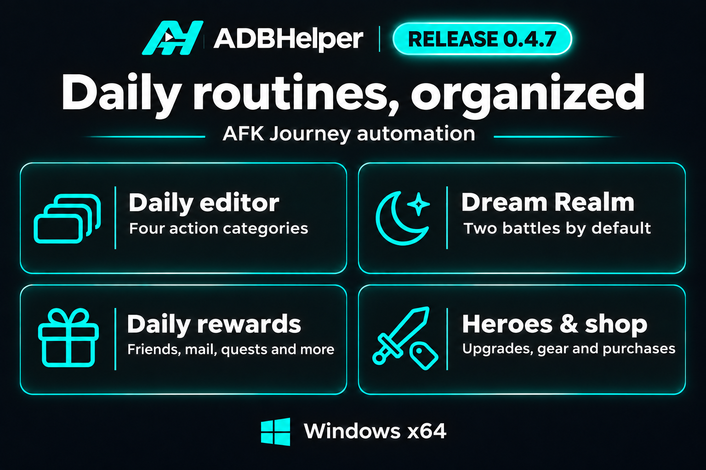

# ADBHelper 0.4.7

Find Daily actions by category, add Dream Realm to your routine, and choose from eleven new reward, hero, and shopping steps.

## Daily routine editor

- Browse **Rewards**, **Battles**, **Heroes**, and **Shop**. Add actions with **+** or drag them into your routine.
- Add Friend rewards, Mail rewards, Battle Pass rewards, Daily Quest rewards with activity milestones, and Guild Quest rewards. The activity panel shows confirmed collections for each step.
- Add Collect Affinity, Level Up All Heroes, Equip New Equipment, Emporium purchases, Noble Tavern Single Pull, or Essence Swap. Single Pull uses one existing Invite Letter. Essence Swap uses eligible essences purchased earlier in the same run.
- Set separate **Diamond**, **Pal-Coin**, and **Dream Fragment** budgets for Emporium. All three budgets start at zero. Full-price affinity items are optional.

## Dream Realm

- Start Dream Realm from the dashboard or add it to Daily. ADBHelper opens the current boss, uses your in-game formation, and selects **Skip** when available.
- The default limit is **two battles per run**. Choose a limit from **1 to 30** in the action settings. Extra attempts with Gold are optional and off by default.
- In Daily, Dream Realm checks the previous day's ranking reward and can finish early once today's ranking is recorded. The activity panel tracks attempts, completed battles, and collected rewards.

## Update dialog

- Release graphics can now appear inline in the patch notes. The dialog keeps the notes readable and offers a GitHub link if the graphic is unavailable.

## Validation

- **140 automated tests passed.** Emulator checks covered Dream Realm battles, Daily reward collection, and navigation to hero, equipment, shop, and recruitment views. Hero upgrades, equipment changes, purchases, recruitment, and Essence Swap still need a full live run.

## Update

Click the green update icon beside **Settings**, review the patch notes, and choose **Download and install**. You can also download **ADBHelper-Windows-x64.exe** below.

Workflow inspiration and original recognition templates are credited to [ADBAutoPlayer](https://github.com/AdbAutoPlayer/AdbAutoPlayer).
