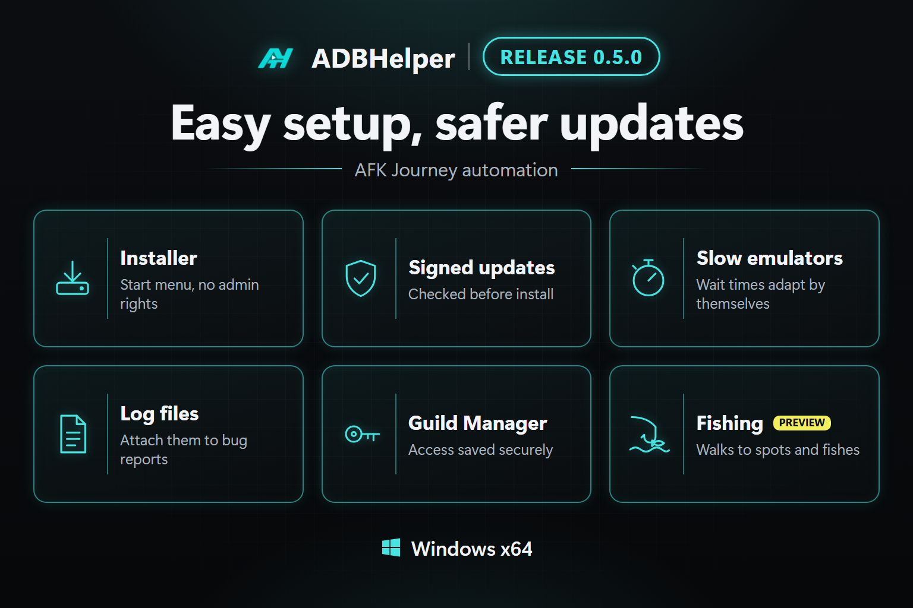

# ADBHelper 0.5.0

Install ADBHelper like any other Windows app, get verified updates, and run it on slower emulators without tuning anything.

## Installer

- New: **ADBHelper-Setup-x64.exe** installs ADBHelper for your Windows user under `%LOCALAPPDATA%\Programs\ADBHelper`. No administrator rights, a Start menu entry, an optional desktop icon, and a normal uninstall in **Windows Settings → Apps**.
- Already using the standalone EXE? Open **Settings → Install ADBHelper → Install now**. ADBHelper downloads the installer, checks it, starts it, and closes the old copy. Your settings and Daily routine stay. Afterwards the installed app shows where the old file is and can delete it for you.
- The standalone **ADBHelper-Windows-x64.exe** stays available and keeps updating as before.

## Safer updates

- Every release is now signed. ADBHelper installs an update only when its signature matches the maintainer's key and the offered version, in addition to the SHA-256 check.
- Update checks run at startup and then every **six hours** instead of every five minutes. **Settings → App updates → Check for updates** still checks right away.

## Works on slower PCs and emulators

- ADBHelper measures how fast your emulator delivers screenshots and gives slow setups more time automatically, up to three times the normal waits. After a game restart caused by a stuck screen it waits a bit longer, then returns to normal. There is nothing to configure.

## Easier bug reports

- ADBHelper writes one log file per day and keeps the last seven days. **Settings → Log files → Open log folder** opens them. Please attach the file when you report a problem.

## Guild Manager Scan

- The API URL and the API key are separate fields now. A key pasted inside the URL moves to the key field by itself. Both are saved in the Windows Credential Manager, so you no longer enter them after every restart. **Forget saved access** removes them.

## Fishing preview

- Start **Fishing** from the dashboard. ADBHelper finds fishing spots on the current region map, walks there with the game's automatic route, and starts the minigame. This action is still **work in progress**, so it asks for confirmation every time. Please watch the emulator while it runs.

## Also new

- Interface texts moved into language files. A translated file in `%APPDATA%\ADBHelper\languages` adds a language under **Settings → Language** without a new build. See [Add a language](https://github.com/KaelanTesseract/ADBHelper#add-a-language).
- **Settings** links to the third-party notices and licenses, which the installer also places next to the app.

## Validation

- **166 automated tests passed**, together with formatting, Clippy, and license and advisory checks. Emulator runs covered Union Campaign with several teams and stopping an action. The installer was installed and started on Windows 11. The move from the standalone EXE to the installer can only run end to end with this signed release.

## Update

Click the green update icon beside **Settings**, review the patch notes, and choose **Download and install**. New here? Download **ADBHelper-Setup-x64.exe** below. Windows may show a SmartScreen notice for a new download; choose **More info → Run anyway**.

Workflow inspiration and original recognition templates are credited to [ADBAutoPlayer](https://github.com/AdbAutoPlayer/AdbAutoPlayer).
