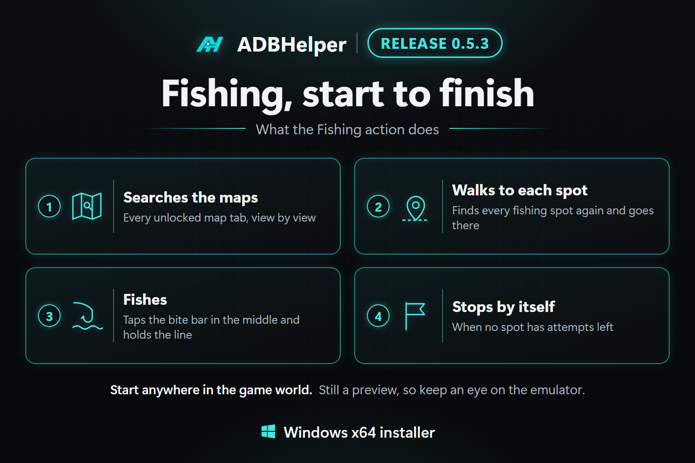

# ADBHelper 0.5.3

**Fishing** now does the whole job: start it anywhere in the game world and it fishes every spot that still has attempts.

## What Fishing does

1. **Searches the maps.** ADBHelper opens the world map, goes through every unlocked tab in the map strip (locked maps are skipped), zooms out, and looks through each map view by view for fishing spots.
2. **Walks to each spot.** It finds every spot again, opens it, and lets your character walk there. When the game opens fishing by itself on arrival, ADBHelper takes over right away.
3. **Fishes.** It casts, taps the bite when the pointer reaches the **middle** of the timing bar (the best chance for bigger fish), and holds the line during the pull. The live screen stream keeps reactions fast.
4. **Stops by itself** when no spot has attempts left. If you start while already standing at a spot, that spot is fished first.

## Good to know

- Fishing is still a **preview** and asks for confirmation before it starts. Please keep an eye on the emulator.
- A spot where nothing bites for a long time is left after a while, so one stubborn spot no longer ends the whole run.
- If a spot cannot be reached, the rest of that map is skipped for this run, and the final message says that some spots or maps were skipped.
- Fishing needs MuMu Player (or another emulator) in portrait 9:16, as before.

## Validation

- **209 automated tests passed**, together with formatting, Clippy, and license and advisory checks. Emulator runs fished several maps end to end: the last full run caught 25 fish across four spots and ended on its own.

## Update

Click the green update icon beside **Settings**, review the patch notes, and choose **Download and install**. New here? Download **ADBHelper-Setup-x64.exe** below. Windows may show a SmartScreen notice for a new download; choose **More info → Run anyway**.

Workflow inspiration and original recognition templates are credited to [ADBAutoPlayer](https://github.com/AdbAutoPlayer/AdbAutoPlayer).
